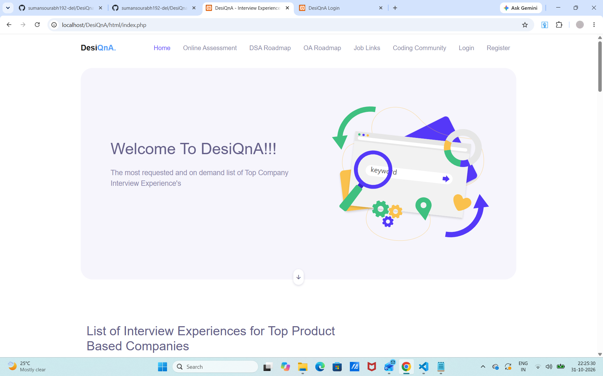
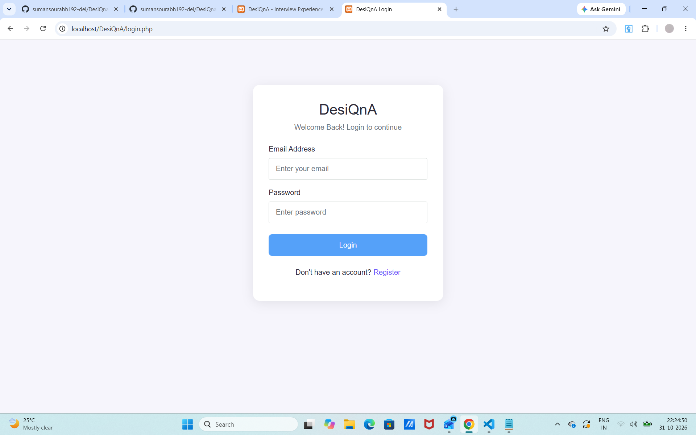

# DesiQnA - Interview Experiences

DesiQnA Interview Experiences Page.

This project helps users explore interview experiences from different companies in an organized manner.

## Tech Stack

- HTML
- CSS
- Bootstrap
- JavaScript
- PHP
- MySQL

## Features

- User Registration
- User Login and Logout
- Password Hashing
- Google reCAPTCHA Verification
- User Profile
- MySQL Database Integration

## Local Setup

1. Install and start XAMPP (Apache and MySQL).
2. Clone or download this repository into `C:\xampp\htdocs\DesiQnA`.
3. Open phpMyAdmin and create a database named `desiqna`.
4. Create the `users` table with these columns:
   - id
   - name
   - email
   - password
   - created_at
5. Copy `db.example.php` and rename the copy to `db.php`.
6. Update the database credentials in `db.php`.
7. Configure your Google reCAPTCHA credentials privately on your local server.
8. Open `http://localhost/DesiQnA/html/index.php`.

## Security

- Do not upload `db.php` or private credentials to GitHub.
- Keep private configuration files outside the public project folder.
 
 ## 📸 Project Screenshots

### Homepage

### Login Page

